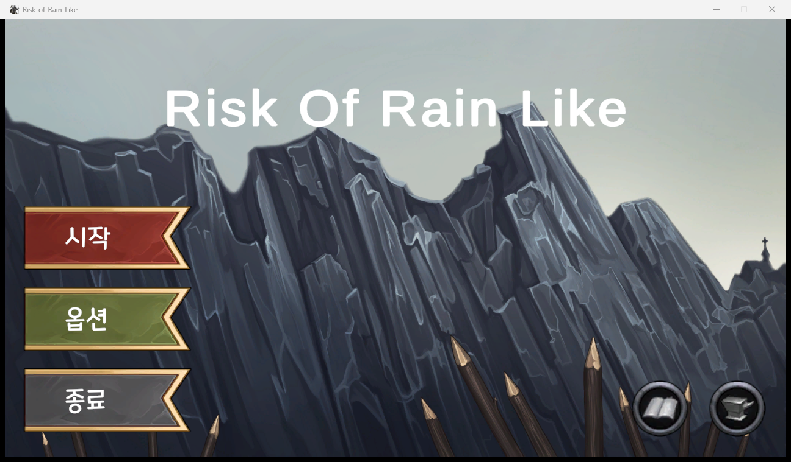

# Risk of Rain Like

『Risk of Rain 2』에서 영감을 받은 3인칭 3D 액션 로그라이트 (Unity, 2023). 영웅을 골라 맵을 탐색하며 아이템을 모으고, 보스 소환 지점을 찾아 버틴 뒤 보스를 쓰러뜨린다.

## 플레이

[Releases](../../releases)에서 `Risk-of-Rain-Like-<버전>-windows.zip`을 받아 압축을 풀고 `Risk-of-Rain-Like.exe` 실행.

| 입력 | 동작 |
|---|---|
| `W` `A` `S` `D` · 마우스 | 이동 · 시점 |
| `Space` | 점프 |
| 마우스 왼쪽 · 오른쪽 | 스킬 1 · 2 |
| `Shift` · `R` | 스킬 3 · 4 |
| `E` | 상호작용 (상자 · 상인 · 문) |
| `Tab` · `Esc` | 정보 · 메뉴 |

## 게임

- **영웅 3종**: 전사 · 궁수 · 마법사. 스킬 슬롯 4개마다 3가지 변형
- **맵 3종**: 들판 · 성 · 바이킹 마을
- **진행**: 보스 소환 지점 탐색 → 버티기 → 복귀 → 보스전 → 승리
- **적**: 박쥐 · 스켈레톤 · 드래곤 · 거북 등껍질, 보스 이블 메이지 · 골렘
- **아이템**: 체력 · 방어 · 힘 · 점프 물약, 성표 · 하이퍼 렌즈 · 날카로운 단검 등. 룰렛 상자(무작위) · 상인 상자 · 타워 상자에서 코인으로 획득
- 시간이 흐를수록 난이도와 가격이 오른다
- 업적

## 문의

버그 · 제안은 [Issues](../../issues)에.
